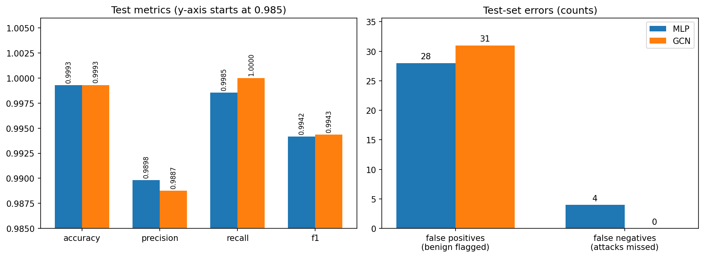

# MLP-vs-GCN-ids

## Overview
**Research Question:** Can a Graph Convolutional Network (GCN) improve network intrusion detection by leveraging relationships between network flows, compared with a Multilayer Perceptron (MLP), which treats each flow independently?

Both models classify each network flow as benign or attack, using a 300,001-flow sample of the improved CSE-CIC-IDS2018 dataset (see [Dataset](#dataset)). They share the same features, data splits, loss weighting, and metrics, so the only difference is that the GCN also sees each flow's neighbors in a graph.

**Short Answer:** In this experiment, the GCN matched the MLP but did not clearly outperform it. The MLP was already near a ceiling (test F1 0.9942), which left little room to improve. The GCN's one advantage was catching every port-scan flow the MLP missed, at the cost of a few extra false positives.

## Results
Test set: 45,001 flows, 6.05% of which are attacks. Precision, recall, and F1 are computed for the attack class.

| Model | Accuracy | Precision | Recall | F1 | False positives | Missed attacks |
| :--- | :--- | :--- | :--- | :--- | :--- | :--- |
| MLP | 0.9993 | 0.9898 | 0.9985 | 0.9942 | 28 | 4 |
| GCN | 0.9993 | 0.9887 | 1.0000 | 0.9943 | 31 | 0 |

- The models differ by 0.0001 in F1 and by one flow in total errors (32 for the MLP, 31 for the GCN).
- All 4 attacks the MLP missed were `Infiltration - NMAP Portscan` flows, and the GCN caught all of them. This is consistent with a port scan looking like an ordinary short flow on its own but suspicious next to the other probes from the same source IP. It is a hypothesis, not a tested explanation, and it rests on 4 flows from a single run.
- The GCN's extra false positives (31 vs. 28) are benign flows it flagged as attacks, so it traded a little precision for perfect recall.

## Method
### Data preparation
- **Task:** binary classification (benign vs. attack). All "Attempted" label variants count as attacks.
- **Features:** 82 flow-statistics columns, including `Dst Port` and `Protocol`. Excluded: row/flow identifiers, timestamps, both IP addresses, source port, `Attempted Category` (label metadata), and the constant column `Bwd URG Flags`. IPs are excluded so the models cannot memorize known attackers.
- **Split:** 70% train / 15% validation / 15% test (210,000 / 45,000 / 45,001 flows), stratified on the binary label (seed 42). Both models use the same split.
- **Scaling:** a signed `log1p` transform to compress heavy-tailed columns, then standardization. The scaler is fit on training rows only.

### Graph (GCN only)
- **Nodes:** the 300,001 flows. **Edges:** each flow is linked to the next 5 flows in time from the same source IP, plus the reverse links, so each flow has up to 5 earlier and 5 later neighbors. This gives 2,769,142 directed edges.
- **Why source IP:** a few destination IPs are hubs (one DNS server receives ~39% of all flows), and linking through them would connect a huge share of the graph. Capping neighbors keeps the graph small and the neighborhoods local in time.
- **Label agreement:** 99.96% of edges join flows with the same label.

### Models
- **MLP:** 82 → 128 → 64 → 1, ReLU, dropout 0.2. Adam (learning rate 1e-3), mini-batches of 1,024, 30 epochs.
- **GCN:** two `GCNConv` layers (128 and 64 units) followed by a linear output layer, ReLU, dropout 0.2. Adam (learning rate 1e-2), full-batch, 200 epochs. All flows' features take part in message passing, but only training flows' labels enter the loss (transductive setup).
- **Shared:** weighted binary cross-entropy (attacks weighted by the benign-to-attack ratio, about 15.5), and the checkpoint with the best validation F1 is the one evaluated on the test set.

## Limitations
- **Random split:** near-identical attack flows from the same burst appear in both training and test sets, so the scores measure recognizing known attack patterns, not detecting new attack types. A time-based split was not used because most attack types occur on only one or two days.
- **The graph partly encodes attacker identity:** each attack type comes from only 1 to 10 source IPs, so grouping flows by source IP also groups them by label. This makes the task easier than real-world traffic.
- **Possible shortcut features:** features such as `Dst Port` may let both models rely on patterns tied to how this dataset's attacks were generated.
- **Different training procedures:** the MLP trained in mini-batches and the GCN trained full-batch, with different learning rates and epoch counts. Neither model was extensively tuned, and the GCN's best validation epoch was 197 of 200, so it may not have fully converged.
- **Scope:** one random seed, one 300,001-flow sample, and binary classification only. Individual attack types, several with 20 or fewer flows, were not evaluated separately.

## Running the Project
Open the notebook in Colab with the link above and run all cells from the top. The notebook installs `torch_geometric`, downloads the sample, and verifies its hash. A GPU is optional: the results above were produced on a CPU runtime. Training is seeded (42), but a GPU runtime may give slightly different results in the last decimal places. If the Colab runtime times out, re-run from the top.

Repository contents:
- `MLP_vs_GCN_Intrusion_Detection.ipynb`: the main notebook (data checks, split, MLP, graph, GCN, comparison).
- `Build_Sample.ipynb`: how the data sample was created.
- `results.png`: the comparison figure shown above.

### Rebuilding the sample (optional)
Since the full dataset is very large (~9.8 GB, zipped), I am only training on a small sample. The notebook [`Build_Sample.ipynb`](Build_Sample.ipynb) shows how I created this sample: the notebook downloads the full dataset (~9.8 GB), randomly keeps 10% of each daily file, then randomly reduces the combined result to about 300,000 rows (seed 42). 

You do not need to rebuild the data sample to run the project; the main notebook already downloads a ready-made sample (`ids_sample.parquet`) from this repository's v1 release and checks its SHA-256 hash, so everyone trains on identical data. [`Build_Sample.ipynb`](Build_Sample.ipynb) is only included in this repository for the sake of reproducibility and transparency. If you rebuild it, the file may differ slightly from the v1 release because of software versions, so treat the v1 release as the official copy.

## Dataset

This project uses the **improved CSE-CIC-IDS2018** dataset from Liu et al. (CNS 2022), which regenerates the flows from the original packet captures with a corrected CICFlowMeter and fixes labeling errors in the original release.

- **Source:** https://intrusion-detection.distrinet-research.be/CNS2022/Datasets/CSECICIDS2018_improved.zip
- **Sample used here:** the full dataset is ~9.8 GB (zipped), so the notebook downloads a pre-built sample (`ids_sample.parquet`, 300,001 rows × 91 columns) from this repo's [v1 release](https://github.com/ClarenceBallensky/MLP-vs-GCN-ids/releases/tag/v1). The notebook checks its SHA-256 hash so everyone trains on identical data.
- **How the sample was made:** rows with missing values were dropped, 10% of each daily CSV was sampled at random, and the combined result was sampled down to ~300k rows (seed 42).

### Citations
- L. Liu, G. Engelen, T. Lynar, D. Essam, W. Joosen. "Error Prevalence in NIDS datasets: A Case Study on CIC-IDS-2017 and CSE-CIC-IDS-2018." IEEE CNS, 2022. doi:10.1109/CNS56114.2022.9947235
- I. Sharafaldin, A. Habibi Lashkari, A. Ghorbani. "Toward Generating a New Intrusion Detection Dataset and Intrusion Traffic Characterization." ICISSP, 2018. (original CSE-CIC-IDS2018 / CIC-IDS2017 data)
- T. N. Kipf, M. Welling. "Semi-Supervised Classification with Graph Convolutional Networks." ICLR, 2017. (the GCN layer)
- M. Fey, J. E. Lenssen. "Fast Graph Representation Learning with PyTorch Geometric." ICLR Workshop on Representation Learning on Graphs and Manifolds, 2019. (the library used for `GCNConv`)
